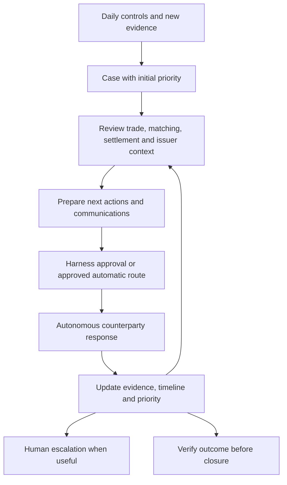
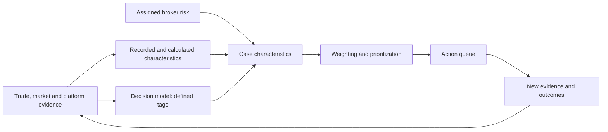
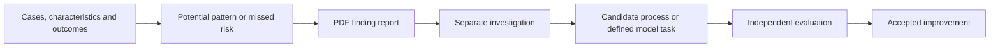

# Ops-harness: continuing interview and product direction

Updated 13 November 2026 with the [decision-audit interview](../interview-handoff.md#decision-audit-interview) and subsequent privates-agent correction. Starting brief, not an approved implementation specification. The harness interview is underway; do not restart settled questions. Principal harness implementation begins in month 2. See [direction](../project-direction.md), [shared terms](shared-terms.md) and [interview order](../README.md).

## Product and authority boundary

Build a licensable application that becomes the operations professional's main middle-/back-office interface. The commercial product is the leading goal; professional development is second. Its advantage is identifying which operational issues deserve action, investigating them and advancing appropriate work.

The initial harness covers **reconciliation, settlement, reference-data maintenance, financing and treasury**, developed incrementally. Investment performance, full accounting and regulatory reporting are not initial harness objectives. Instrument and documentation readiness belongs in setup, where explicit recorded assumptions about agreements and eligibility suffice; it is not an ongoing harness capability or an executed-document gate.

**The nine actors are the autonomous simulated reality.** After setup, funds, PBs, OTC counterparties, FCMs, administrators, market-data providers, loan agents, privates-agent and executing brokers run on schedules and agents with zero manual intervention. Loan agents handle syndicated loans; privates-agent handles private-loan servicing and private-warrant agency. Their strongest frontier decision-makers act from prescribed incentives and researched examples; Patrick does not approve or override their runtime choices. Their world must run without this harness.

**Ops-harness and support work are hands-on.** Patrick may develop human-in-the-loop steps here, in ops-infra and in shared integration/replay/valuation work. The harness consumes delivered evidence and takes authorized actions against the world. It does not control the private state or decisions of all participants.

Harness communications to other institutions initially require approval of the **exact message and recipients**. Material changes to the content or supporting evidence require fresh approval. Specific communication types may later be placed on an auto-approval list once reliability can be demonstrated; their qualification criteria remain open. This restriction does not apply to actor-to-actor messages.

The harness may **autonomously correct fund-side OMS and instrument-master records within its authorized access**, retaining an audit trail. Its business-record write authority ends at the fund vertical. Every other vertical must have a mechanism to correct its own records; the harness may communicate discrepancies or correction requests through the approved communication route.

Fund changes must use a legitimate operator/action interface with defined access. This authority does not grant unrestricted private-state access or human overrides of institutional decisions. Exact interfaces and permitted record operations remain for design.

## Confirmed morning experience and 80% target

Present a clear prioritized list: what needs action, why it matters, what evidence supports it, what has already been done, and the next available step. Keep pending cases current as evidence and responses arrive.

The **80% ambition covers classifying breaks and prescribing steps to investigate their cause**, independently for **each supported break family**. It does not promise that 80% of breaks are closed. A delivery failure can be understood and have all available automated work completed while the trade remains unsettled. The exact family definitions, review rubric, cases and delivery milestone remain open.

Initially, held-out evaluation uses fresh cases with familiar scenario patterns and document layouts. Broader generalization testing comes later. Report false-clean conclusions, unsupported certainty, abstention and unnecessary escalation, but do not make them separate initial acceptance gates. The per-family 80% target is the initial performance gate; representative failure/control checks are separately required at first integrated acceptance.

Patrick envisages automating routine work currently spread across 5–10 people's checklists, leaving a person to handle consequential exceptions. This is a product ambition, not a validated staffing or productivity claim. Retain distinctions between a completed control, an identified discrepancy, an investigation step, a diagnosed cause, a pending external action and a verified resolution.

## Confirmed example workflows

Names below identify Patrick's examples; they do not establish access to real firms or services.

**Funding:** explain that a PB requires a specified amount and connect it to changes in particular positions. Distinguish a calculated requirement, a communicated call and evidence of a funding movement.

**Bilateral OTC option:** the fund records an SPX December 6000 put while a counterparty valuation statement reports a call. Inspect the trade-date term sheet and other available evidence; price may support investigation but does not by itself prove contractual terms. Prepare a message to the counterparty operations team and sales trader to establish agreement. Bilateral OTC options are now explicitly in month 1; exact contract variants remain open.

**Failed HY corporate-bond purchase:** the PB reports that yesterday's scheduled settlement failed. The desired harness work is to:

1. Research issuer/company news that might make the fail more sensitive. Bloomberg, Google Finance and Massive were examples, not chosen integrations or acquired data.
2. Prepare an internal trader alert about the failed delivery, including relevance to further activity with the executing broker.
3. Draft an executing-broker request for delivery status.
4. Keep a pending-resolution case with timestamped completed actions, outstanding work and severity.
5. Ask the PB for available depository/settlement-system evidence about the fail reason, such as a reported lack of delivering inventory. Preserve the source and certainty of any explanation.
6. Review the T+0 affirmation/matching evidence and report what was agreed, when and how.
7. Monitor replies automatically, link them to the case and update status and priority.

The longer-term aim is for agents to establish whether trade details, net money and instructions agree, isolate the remaining delivery problem, and focus escalation appropriately. Patrick gave a continuing fail two days after settlement as an example where he would pick up the phone; this is not yet a universal timeout rule. Actor counterparties still decide their own responses.

This graph shows the external-communication workflow. Fund-record corrections use the separately authorized autonomous route above. Detailed control coverage, interfaces and closure rules still need design.

## Evidence, history and failure handling

Use authority rules specific to the fact and workflow where possible, supported by investigation of provenance and timing. Several agreeing feeds may share an error; the fund's view is not automatically correct. Allow an unresolved conclusion.

Preserve earlier deliveries, what was known at the time, and correction lineage. Require evidence-backed outcomes: a technical acknowledgement is not settlement. Detailed lifecycle milestones belong in the product and actor interviews. Start with evidence playback and decision/event logs; a complete package for reconstructing processing is deferred.

When a workflow cannot proceed safely, mark it incomplete or uncertain, hold dependent work and let independent actors and workflows continue. Missing input is not a clean reconciliation. First integrated acceptance must include representative missing-input, duplicate-delivery, uncertain-submission, provider/quota-failure, stale-approval and untrusted-document-instruction checks, including protection against duplicate business effects. These checks are requirements, not reported test results.

## Tags and priority scoring

Patrick means non-generative, typed decision models such as **Jev**, not simply small LLMs. They assess defined questions/options and return structured decisions, scores or probabilities. Frontier agents perform open-ended investigation and institutional judgment. Code/workflow logic combines relevant characteristics into the priority score.

For the failed trade, confirmed candidate characteristics are product family, trade net money, assigned executing-broker risk, recent bond-price volatility and affirmation/matching status. Some are direct facts or calculations; others may need interpretation by a decision model. Preserve those distinctions and source timing rather than asking a model to guess a known amount.

A higher priority score means earlier attention. It is not automatically a probability of loss or model confidence. In the example ordering, the put/call discrepancy precedes funding, which precedes the HY fail; issuer news/volatility can elevate the fail and the size of funding matters. This illustrates judgment, not a universal fixed order.

**Deferred at Patrick's request:** scoring weights, how to establish them, the full tag taxonomy, and whether/how a few queue categories are used. Do not proliferate categories or ask him to settle weights before he is ready. Preserve the scoring question for the relevant later stage.

## Months 2–4 and learning

Months 2–3 develop operational agents, typed decision-based characterization, case histories and risk-prioritized workflows. Month 3 still includes UI work and conditional fundraising exploration. Month 4 begins experiments with cheaper, less reasoning-intensive models for defined subordinate tasks, then open-model weight changes to approach frontier-model task performance. The strongest frontier models remain at the top of the verticals.

Post-training means changing open-model weights. Editing a prompt, tagging cases or adjusting priority weights is a different kind of change. Jev-style decision models are a separate role, not a synonym for either post-training or cheaper investigative agents. Specific providers, model versions and acceptance thresholds are not selected by this brief.

Across accelerated simulations, characteristics and outcomes may expose recurring patterns, predict problematic trades or reveal risks missed by existing controls. **The agreed finding output is a PDF report, followed by a separate investigation led by Patrick until a clearer process can be developed.** This does not authorize automatic policy changes.

Proposed report contents: finding, supporting cases, event chronology, assumptions, alternative explanations, estimated relevance and questions for investigation. Retain the difference between an observed pattern, a model prediction and a verified cause. Neither 1,000 simulated trading days per real day nor stress-driven break multipliers are measured capabilities.

The reporting/investigation step is confirmed. Detailed report format, evaluation and promotion mechanisms remain proposals to specify.

The later specialist-tool backlog retains a distressed-debt/agent-form reviewer. It is a document-analysis candidate, not legal authority. Scheduled research–critic–human-review work is excluded from the current direction; standalone forensic-accounting and specialist OTC-settlement-tool ideas remain in the historical archive, not the active backlog.

## Proposed acceptance examples

- A case preserves source versions and knowledge available at each time; a revised conclusion is explainable.
- Classification and the prescribed investigation path are evaluated separately from final settlement/resolution, with the 80% target applied to each supported break family.
- The queue shows principal risk characteristics; changed evidence can alter priority without erasing earlier actions.
- External messages use the approved exact content and recipients; material changes require renewed approval. Fund-record corrections can be autonomous within authorized access, while other verticals correct their own records. Actor responses never await Patrick acting as the counterparty.
- An incomplete source or uncertain cause remains visible; the system does not fill gaps from hidden evaluator answers.
- Held-out cases initially use familiar patterns/layouts; additional quality measures are reported without separate performance gates. Candidate cheaper models are tested on defined tasks using independent outcomes/reviewed cases as well as a frontier comparison. Training cases and held-out evaluation cases remain separate.
- An uncertain submission or repeated delivery does not silently create duplicate business effects; failures hold affected dependencies without stopping independent work.
- A PDF finding leads to a traceable investigation and evaluated proposal, not a silent production rule change.

No runtime performance, probability calibration or model equivalence has been demonstrated by these notes.

## Remaining interview work

Continue with concrete operator cases and the broader month 2–4 map. Do not reopen the autonomous-actor requirement or score-weight questions.

- Define the initial control coverage, supported break families, review rubric and cases for the per-family 80% classification/investigation target.
- Specify fund-side correction interfaces and access, eventual external auto-approval evidence and closure/escalation semantics within the confirmed authority boundary.
- Resolve instrument/source coverage and historical issuer context with the actor and shared-world interviews.
- Choose the first defined subordinate task for model economics/evaluation when that phase begins.
- Refine the PDF finding/investigation workflow, later UI and commercial deployment questions.

## Sources to read selectively

| Source | Use and limit |
| --- | --- |
| [Current direction](../project-direction.md) and [source reconciliation](../source-review.md) | Authority for present intent and superseded proposals. |
| [Retained simulator architecture](../../../../pr1/business/ops-harness/notes/architecture/2026-10-19_simulator-architecture-page-snapshot.md) | Operational domains, evidence independence and role boundaries. Historical repo/technology choices need reconciliation. |
| [Independent-build plan](../../../../pr1/business/ops-harness/notes/planning/2026-10-11_independent-build-plan.md) | Earlier harness concepts and evaluation ideas. Its milestones, Hindsight requirement and narrow scope do not override current direction. |
| [Equity-swap service proposal](../../../../pr1/business/ops-harness/service-offering-equity-swap-lifecycle-agents-id-4296741d.md) | Candidate operator value and workflows. Automatic-action thresholds and commercial promises are not adopted authority. |
| [Trade-interface evidence review](../../../../pr1/business/ops-harness/notes/trade-simulation/2026-10-19_trade-interface-evidence-wiki-page-snapshot.md) | Concrete evidence questions; use the source review for known broken links and historical limits. |
| [Current cross-model workflow](../../README.md) | How to move an interviewed specification into review/planning. Check current commands rather than relying on copied model names. |

Additional sources retained from the earlier interview (not newly verified by this notes update):

- [TypeSafe introduction](https://docs.typesafe.ai/introduction): Jev's typed choice, score and probability interface. The source describes the product; it does not validate performance on these financial cases.
- [Probability calibration](https://scikit-learn.org/stable/modules/calibration.html): context for testing probability quality on the actual decision population; no calibration method is selected here.
- [Archegos investigation](https://www.sec.gov/Archives/edgar/data/1159510/000137036821000064/a210729-ex992.htm): real example for institutional incentives, delayed action and the distinction between observed warnings and effective intervention. It is not a specification for every simulated PB.

## Fresh-session prompt

> Continue the ops-harness interview from this brief, project-direction.md, shared-terms.md and the decision-audit interview in interview-handoff.md. Preserve all nine actors as unattended scheduled/agent-driven reality; loan agents handle syndicated loans and privates-agent handles private loans and warrants. Patrick does not approve or override institutional runtime choices. The harness may autonomously correct authorized fund records only; other verticals correct their own records. External communications initially require exact-message/recipient approval. Retain all five operational domains, setup-only readiness using explicit assumptions, the per-family 80% classify-and-prescribe target, evidence playback first and the initial failure/control checks. Other quality measures are reporting only; initial held-out cases use familiar patterns/layouts. Preserve the risk-prioritized morning workflows, typed Jev-style decision models, PDF findings followed by separate investigation, and month-4 cheaper/open-weight experiments with frontier leadership retained. Weights and a small number of categories remain deferred. Use graphs and concrete cases, asking one multiple-choice question at a time. These are planning inputs, not authority to implement the system.
