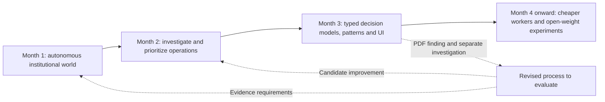
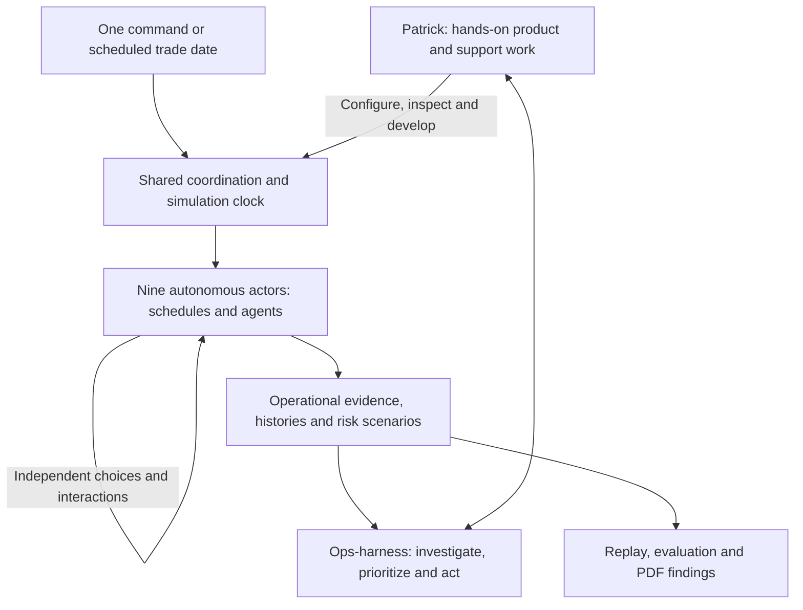

# Project direction

Updated from Patrick's interviews on 13 November 2026, including the decision-audit review and subsequent privates-agent correction. This records confirmed intent; it is not a feasibility finding, delivery commitment or completed specification. The [interview handoff](interview-handoff.md#decision-audit-interview) retains the complete decision record.

## Product and priorities

**Primary goal:** build a licensable application for hedge-fund operations professionals over a one-year horizon. At its heart, and potentially comprising the entire application, is a portable harness that becomes the user's main interface for completing middle- and back-office tasks.

Patrick calls the vision **OPS 2.0**. The ambition is to make the product indispensable to investment managers' operations teams in the US, comparable in importance to Bloomberg for front-office personnel. OPS 2.0 is a working vision label, not a final cleared company or product name.

**Secondary goal:** acquire and demonstrate the skills to remain a highly sought-after hedge-fund operations professional or executive who can implement this transformation. Building a commercial product is the leading objective; professional development is a substantial parallel benefit.

Patrick brings 16 years of experience across buy-side and sell-side operations. His intended advantage is the combination of daily operational knowledge and practical understanding of applying AI to financial operations. He expects substantial reductions in traditional operations staffing over the next one to five years. That is his strategic thesis, not a verified labor-market forecast.

## Shared foundations and development gates

Initially build reusable OMS and instrument-master modules for funds, shared simulation support and ops-harness into a solid base across the intended instruments. Design for each independent actor eventually maintaining its own versions, selectively adopting shared improvements after compatibility checks. Private data remains separate from the outset. This does not select a central mutable service, repository layout or migration date.

FINOS CDM remains the selected foundation for applicable fields, price representation and verified calculations. Establish requirements per product before dependent implementation: applicable CDM conditions, calculation inputs, simulation additions and recipient needs. Research uncovered capabilities and obtain Patrick's approval of a supplement before adoption. Preserve versioned master terms and each trade's agreed terms; updates do not silently amend contracts.

Readiness checks belong to setup only; explicit recorded assumptions about agreement coverage and eligibility suffice. The harness's operating domains remain reconciliation, settlement, reference-data maintenance, financing and treasury. Operational scenarios still need their selected evidence.

Develop two differently shaped synthetic recipient profiles early and verify equivalent economics. Independently verify and reuse historical examples matching selected profiles. Require representative failure/control checks at first integrated acceptance. Retain OpenCode-first development and portable interfaces/skills, with infrastructure owned by ops-infra. Keep the form reviewer as a later candidate; scheduled research/critic work and other specialist-tool ideas are outside the active backlog.

## Why build a simulated world first

The simulated financial world is development infrastructure for the product. It should contain independent actors that mirror actual operations stakeholders, produce the kinds of data those stakeholders really send, and reflect real-world constraints and interactions.

The aim is credible operational situations, not merely large quantities of random rows. The world should make it possible to develop, test and improve the harness using realistic evidence. The actor roster, strategy population, product breadth and historical replay direction are now agreed below. Exact scenarios, communication routes, run duration and acceptance details remain for the vertical interviews.

Patrick wants coding agents to do much of the simulation implementation. His hands-on work belongs in setup, ops-harness, ops-infra and shared integration, replay and valuation work. Once configured, the nine actors run fully autonomously on schedules and agents, without human approval, manual role-playing or overrides of their decisions. The world must run even when ops-harness is absent.

## Intended sequence

Months below are relative project stages. A calendar kickoff and exact end dates have not been agreed. Do not silently substitute the older January 2027 preparation deadline for this new one-year product horizon.

| Stage | Patrick's intended outcome | Still to define |
|---|---|---|
| Month 1 | All nine actors run unattended from a command or schedule, with independent records, frontier-model institutional judgment, realistic financing and replayable historical days across the product scope below. | Portfolios, product variants, events, delivery routes, autonomous failure handling, volumes and run acceptance. |
| Month 2 | Frontier operational agents investigate breaks, prescribe next steps, prepare communications and maintain a risk-prioritized morning work queue. | Detailed control coverage, authorized fund interfaces, evidence access and evaluation cases. |
| Month 3 | Continue operational agents and introduce/refine non-generative decision models such as Jev for defined tags, categories and likelihoods. Analyze patterns across accelerated simulations. Begin UI work; fundraising remains conditional on progress. | Questions/tag definitions, scoring weights, a small number of categories, evaluation and UI details. Patrick defers scoring design until later. |
| Month 4 onward | Evaluate cheaper, less reasoning-intensive models on defined subordinate tasks, then experiment with open-model weights to approach frontier task performance. Reassess infrastructure for scale. | Candidate tasks/models, training examples and rights, quality/economic gates and timing of each experiment. |
| Through year 1 | Develop a licensable, compelling operations application. | Commercial release criteria, design partners, pricing, deployment/support model and production validation. |

The distinction matters: **Jev-style decision models are not shorthand for cheaper LLM agents.** They answer defined questions with typed outputs/probabilities. Months 2–3 build agents and decision-based characterization; month 4 begins cheaper-worker experiments and then open-weight changes. The strongest frontier models remain the decision-makers at the top of the verticals, as well as driving architecture. They are not the intended replacement target.

Discoveries should be exposed in a PDF report. Patrick then launches a separate investigation until a clearer process can be developed. Automatic changes to live policies or automatic promotion of a discovered pattern are not approved. The plan does not assume future model advances or successful post-training have already occurred.

## Confirmed versus not yet decided

Confirmed: commercial product first; professional positioning second; simulation before the principal harness build; ambitious one-month simulation target; staged model strategy; later UI and conditional fundraising. The month-1 decisions and interview sequence below supersede earlier open roster questions.

Not yet decided: detailed run acceptance, product-to-strategy assignments, complete control coverage, tag/scoring design, detailed evaluation cases, authorized fund interfaces, customer deployment and release economics. Actor autonomy, fund-only autonomous harness corrections, exact external-message approval, the PDF-led investigation path and the meaning of open-weight post-training are settled below.

Earlier research contains useful constraints: separate participant state, versioned evidence, retained histories, independent checks, and hidden evaluation answers. Preserve these while applying the selected initial evidence-playback scope; full processing reconstruction is deferred. Do not present every earlier proposed implementation as newly approved.

## Relationship to earlier plans

- The September independent-build plan's narrow demonstrations remain reusable ideas. They no longer establish the overall deadline or commercial objective by themselves.
- The current `sim-funds` cash-equity demonstration remains the documented starting point for that vertical. It is not equivalent to completing every non-harness vertical in month 1.
- Earlier consulting, 100%-client-owned code and naming proposals must be reconciled with the explicit licensable-product goal before becoming commercial commitments.
- Model choices should follow demonstrated task quality and operating cost. The timing above expresses the desired investigation sequence, not proof that smaller models can already perform every intended task.

## Confirmed month-1 world

The nine actor verticals are [funds](funds.md), [prime brokers](prime-brokers.md), [OTC counterparties](otc-counterparties.md), [FCMs](fcms.md), [administrators](administrators.md), [market-data providers](market-data.md), [loan agents](loan-agents.md), [privates-agent](privates-agent.md), and [executing brokers](executing-brokers.md). The separate privates-agent handles private loans and private warrants; loan agents cover syndicated loans only. This supersedes the eight-vertical constraint. Custodians are not required in month 1. Matching, affirmation and third-party reconciliation-platform evidence belongs inside the administrator vertical; there is no separate month-1 post-trade vertical. Distinct provider roles and outputs still need to be identifiable.

Shared coordination, replay, exchange definitions and evaluation are covered by [shared world](shared-world.md). These are support responsibilities, not another financial institution. Infrastructure remains owned by `ops-infra`.

### Autonomous actors and hands-on support

**Once set up, all nine actors must run with zero manual intervention.** A command or schedule such as “simulate trade date November 14” starts the necessary work across all nine through shared coordination. This is an interface requirement, not an implemented command or selection of a particular year/calendar. Runs must not ask Patrick to approve actor messages, decide an actor's response, enter an ordinary missing business input or manually start each vertical.

Institutional agents use the strongest frontier models for judgment, informed by researched real-world examples and their own incentives. Patrick does not override their run-time choices. Institutions pursue their own commercial and capital-protection interests; they need not cooperate perfectly or make decisions that appear wise in hindsight. Their choices, communications and consequences form the observed history. Preserve the already-agreed private-state and evidence boundaries. Autonomy does not grant access to another actor's books or hidden evaluation answers.

Ops-harness, ops-infra and shared integration/replay/valuation work remain hands-on areas where human-in-the-loop steps may exist. A hands-on valuation development workflow does not make routine actor valuation depend on manual input: configured runtime capabilities must be callable automatically. Business exceptions can remain open or disputed, but actor handling is autonomous. Technical inability to continue must produce an explicit failure/status rather than a hidden request for manual completion. Hold the affected workflow and dependencies while unrelated work continues; report incomplete or uncertain outcomes explicitly.

### Strategy population and relationships

Start with exactly one fund for each strategy type, using these names:

| Equity and mixed strategies | Credit strategies |
| --- | --- |
| `equity-arb-1` | `credit-distressed-1` |
| `convert-arb-1` | `credit-vol-1` |
| `equity-vol-dispersion-1` | `credit-ig-1` |
| `equity-activist-1` | `credit-hy-1` |
| `equity-longshort-1` | `credit-privates-1` |
| `equity-quant-1` | |
| `equity-privates-1` | |

One strategy instance maps to one fund. The suffix allows later instances such as `equity-arb-2`; multiple instances are not part of the initial population. This is a deliberate simulation structure, not a claim about the organizational structure of actual managers.

Each fund has exactly one administrator. It may have multiple PB, FCM, OTC-counterparty and executing-broker relationships; exact institutions and counts remain open. Each trade is allocated in full to one applicable financing relationship, with no splitting across PB/FCM accounts in month 1. Initial examples use one fund per trade; cross-fund block allocation is a later candidate. Fund-side financing allocation must be rule based and belongs in the fund vertical initially because it is needed to produce the outbound trade file.

The strategies need substantive research grounded in real portfolio practices. Patrick identified his experience at Elliott Management, Arini and G-Research, and his forthcoming role at Highbridge Capital Management, as context he can bring to the interviews. These are research leads, not adopted replicas of those firms, verified strategy mappings or supplied datasets.

### Product scope

All of the following are required by the end of month 1, at credible-workflow depth rather than broad lifecycle coverage:

- Cash equities and listed futures.
- Corporate bonds, including a bounded coupon-entitlement case, and convertible bonds initially at trading/valuation depth; conversion lifecycle is deferred.
- Bilateral equity swaps, bilateral variance swaps and bilateral volatility swaps.
- Bilateral OTC options, added explicitly during the continued interview; exact variants remain to select.
- Cleared single-name CDS and cleared index CDS.
- Private warrants, including cash and cashless exercise with pending/partial delivery handling.
- Syndicated loans, initially fully funded secondary positions and assignments; unfunded commitments are deferred.
- Private loans, as a separate instrument type: cash-interest and simple explicit PIK servicing of an existing funded loan, last in the month-1 instrument sequence.

Include bounded observation-driven expiry settlement for variance and volatility swaps, with explicit units, observations and corrections; verify valuation separately. Retain the equity-swap defaults hierarchy and eight terms detailed in [funds](funds.md), subject to CDM alignment and verified cash conventions. ICE/IceLink leads CDS operational research, checked against exact contracts, series and clearing routes. None of these choices certify archived calculations or vendor formats.

The roster does not assign every product to every strategy or counterparty. Eligible variants, routes, agreements and data must be established during research. The OTC-option addition does not approve listed options or FX, and a listed-options packet does not establish bilateral OTC terms or workflows. Further additions need an explicit decision.

### Execution, evidence and financing

The fund and the execution-side institution record their sides independently. Execution, internal booking, allocation, matching, settlement and financing must remain distinguishable. The fund routes PB-eligible activity through the relevant broker/PB relationships, records bilateral trades against an OTC counterparty, and allocates applicable cleared activity to an FCM. Exact execution and clearing roles for each product remain an interview task; an FCM allocation is not by itself an execution record.

Patrick described exchange-fill evidence for exchange-traded activity and instrument-specific high-touch communications such as recaps, term sheets, confirmations and CDS matching evidence. Those examples establish the required fidelity of communications; they do not settle a universal message sequence or establish access to actual venue records.

T+0 emphasizes complete trade capture and agreement of economics. Subsequent days include unresolved breaks, settlement preparation and settlement, reporting and selected lifecycle activity. No universal T+1 settlement deadline is implied. Reports and on-demand status should be considered in the interviews; building replicas of vendor portals is not yet agreed.

Funds, PBs, FCMs and OTC counterparties have realistic mandates and constraints. PBs, FCMs and OTC counterparties calculate independently, produce financing/margin reports and can issue calls. Opening portfolios should have sufficient headroom for several initial days of ordinary processing before financing pressure becomes the main topic. Do not achieve that by disabling calculations. Choose realistic strategy portfolios first, then size opening cash and collateral around them. Routine margin calls and contractual cash flows remain active.

Loan agents service syndicated loans; the privates-agent services private loans and private warrants. Patrick expects loan-agent reporting to borrowers and scope for borrower questions. Lender-facing evidence, communication direction and the minimum borrower representation need confirmation in the relevant vertical; no separate borrower vertical has been approved.

### Replay and evolving examples

Use a historical market baseline, with fictional portfolios and trades. Initially retain delivered evidence and decision/event logs for playback and inspection; the fuller package for reconstructing processing is deferred. The exact date range, replay length, market sources, speed and operator controls remain open. Initial portfolios should be consistent with the chosen period. Missing historical observations must be exposed and resolved explicitly rather than silently replaced with fabricated data described as historical.

Files, reports and examples will evolve. Preserve actual actor decisions, messages and delivered evidence for playback. Do not claim complete processing reconstruction from these logs. A fresh stochastic rerun may make different choices; distinguish playback of a recorded history from a new or counterfactual run. Keep private records separate, deliver permitted evidence and isolate hidden evaluation answers.

Patrick wants accelerated scenarios and the ability to rewind a failure, inspect the sequence and investigate alternatives. “1,000 trading days in one actual day” is an ambition, not measured throughput. His example of 3x trading volume yielding roughly 10–20x breaks is a stress hypothesis, not a calibrated law. Distinguish imposed scenario assumptions from patterns the model discovers. Randomness and Taleb-inspired attention to extreme outcomes are motivations; no distribution or formal game-theory method has been selected.

## Harness outcomes and decision models

The morning experience is a clear prioritized action list with evidence and next steps: for example, a funding requirement explained by position changes, a put/call discrepancy investigated against the trade-date term sheet, or a failed bond delivery with queries prepared and responses monitored. The [harness brief](ops-harness/starting-point.md) preserves the detailed examples.

**The 80% ambition is classification plus a prescribed investigation path across breaks**, not 80% of breaks fully resolved or 80% of financial risk removed. A case may remain open after all available actions have been performed. The broader workload vision is to automate routine work spread across 5–10 operations staff so a person can focus on consequential exceptions. Each supported break family must meet 80% independently. False-clean conclusions, unsupported certainty, abstention and unnecessary escalation are reporting-only measures initially. Use fresh held-out cases with familiar scenario patterns/layouts first; broader generalization comes later. Exact families, scoring, sample sizes and a firm delivery date remain open.

Harness communications to external verticals require human approval initially. Particular communication types may later enter an auto-approval list after reliable confidence/evidence is established. This applies to ops-harness, not to the autonomous actor-to-actor communications. The harness may autonomously correct fund OMS/instrument-master records within authorized fund access, with an audit trail. Other verticals must correct their own records. External-message approval covers exact content and recipients; material content or supporting-evidence changes require renewed approval.

Decision models apply defined tags/questions, including product family, trade net money, assigned broker risk, recent volatility and affirmation/matching status. Preserve direct facts/calculations without requiring a model to infer them. Combine characteristics into a priority score: higher means earlier attention. Exact weights and a small number of possible queue categories are explicitly deferred. In Patrick's example, put/call discrepancy ranks ahead of funding and then the failed HY bond; news/volatility and funding size can change the order. Do not hard-code this as a universal hierarchy.

The accumulated characteristics and outcomes support investigation of predictive patterns and missed risks. Findings go to PDF and a separate investigation. They do not silently rewrite the operating process. Open-weight post-training is a separate model-development step, not another name for adding tags, changing score weights or updating an agent's instructions.

## Agreed preparation and next interviews

Patrick requested the starting briefs now and accepted two focused follow-ups: a strategy/portfolio pass before finalizing the fund plan, and joint instrument-workflow sessions where multiple actors must agree. Neither requires completing twelve full strategy interviews before creating the briefs.

The [ops-harness interview](ops-harness/starting-point.md) has begun and now includes months 2–4, shared terms and the autonomous-world boundary. Continue from its remaining questions rather than restarting it. Then follow the nine actor briefs top to bottom in the [overview](README.md#interview-order-and-month-1-effort), followed by the shared-world/infrastructure review. Use graphs of the roadmap, actors and selected workflows. This is interview order, not a serial build schedule.

Shared terms belong to ops-harness. In this preparation package they live under `ops-harness/`; when an owning application repository is established, move the canonical glossary there and update links rather than maintaining competing copies. A glossary does not create a central state store or prescribe a wire schema.

Patrick increased the fund effort allocation to roughly 25% and requested a lower relative loan-agent allocation. The earlier planning budget is recorded once in the overview and needs revision for the new ninth vertical; no new percentage split has been agreed. Only those directional changes were explicitly chosen by Patrick; the exact remaining percentages are a proposed allocation, not a feasibility assessment.
