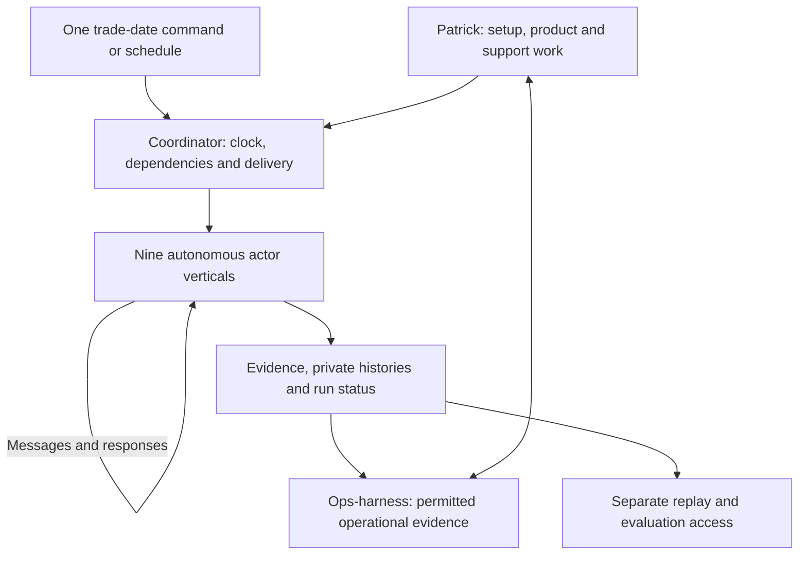

# Shared world, replay and evaluation

Interview starting brief, 13 November 2026. Read [project direction](project-direction.md), [shared terms](ops-harness/shared-terms.md) and the [vertical map](vertical-map.md). Earlier planning proposal: **14%** for integration/replay/evaluation and **2%** for incremental infrastructure; the nine-vertical budget remains to be revised. These support responsibilities do not add financial actors or mandate new repositories.

## Purpose and confirmed constraints

Connect all nine actor verticals into an unattended simulated reality an operations professional can inspect and replay. One command or scheduled trigger starts the necessary actions for a specified trade date across the actors. The world must run without ops-harness or Patrick manually operating any institution. The goal is a development/evaluation environment for the licensable operations product.

Confirmed: twelve strategy funds, the full product list including bilateral OTC options, whole-trade allocation by fund rules, independent financing calculations and reports, historical market observations and fictional portfolios/trades. Choose strategy portfolios first and size opening funding around them, with routine calls/cash flows active; private loans are the last month-1 instrument. Exact replay duration, dates and exception cases remain open. Manual actor intervention is not an open design choice: actor agents handle the cases autonomously, including leaving a business issue legitimately unresolved.

Independent actors must not read each other's private books. The harness must not read hidden expected answers. Sharing documented exchange meanings and available market observations does not imply sharing private accounting, risk limits or future events.

## Autonomous execution and hands-on support

The nine actors run on schedules and agents with **zero manual intervention after setup**. Their strongest frontier leaders exercise judgment using researched precedents, prescribed incentives and their own information. Patrick does not approve or override their decisions. Choices that turn out badly are simulation outcomes to study, not results to manually repair until the world agrees.

Ops-harness, ops-infra and shared integration, replay and valuation work remain hands-on areas. Human oversight there does not create per-message or per-trade gates inside the actors. Configured valuation capabilities must be invoked automatically during runs; shared implementations do not merge private books or replace actors' independent calculations.

The intended entry point is conceptually `simulate trade-date <date>` or its scheduled equivalent; syntax and implementation remain to select. It identifies the configured world and date, coordinates due work and message-driven follow-ups in the appropriate simulated-time order, and produces a run history/status. It need not make every institution trade on every date, but it must invoke all required actor activity without separate manual launches.

Business exceptions become recorded actor actions, disputes, waiting states or unresolved cases. Missing infrastructure, model access or indispensable configured input is a technical run problem: expose the failure/status instead of silently awaiting manual completion or pretending the business day succeeded. Hold the affected workflow and dependencies while independent work continues. Ordinary scenario work must not ask Patrick to supply a counterparty response.

## Proposed minimum support responsibilities

These are responsibilities to resolve in the shared interview, not an approved service architecture:

| Responsibility | Proposed result | Boundary |
| --- | --- | --- |
| Scenario definition | Opening conditions, identified participants, selected activity and deliberate exceptions | Setup readiness may use explicit recorded agreement/eligibility assumptions; distinguish these from observed evidence |
| Shared foundations | Initially shared OMS/master modules, CDM-based product gates and versioned terms | Design for independent actor variants and selective updates; no shared private books |
| Clock and delivery | Advance scheduled events and actor follow-ups from the single run trigger | Separate effective/as-of time from availability; no manual message routing or future-information leakage |
| Exchange agreements | Small reviewed definitions for the selected evidence flows | Common meaning and versioning, not one shared mutable ledger |
| Run identity and playback | Initially retain delivered evidence and decision/event logs | Full processing reconstruction is deferred; playback and a fresh stochastic trial are different operations |
| Operator/evaluator views | Inspect the operational evidence and independently check outcomes | Evaluation answers remain outside the actors' and harness's accessible data |
| Failure/correction handling | Reproduce selected delays, rejects and amended evidence | Preserve what each participant actually knew at the time |
| Runtime coordination | Invoke all required configured actors and collect results without runtime prompts | Provisioning, access and recovery stay with ops-infra |

An existing directory-based exchange or small runner may be enough initially. Choose transport and packaging after the first concrete flows are agreed; no broker, distributed scheduler, universal API or separate ops-contracts package is selected by this brief.

## Cross-actor questions to settle before dependent plans finalize

1. **Execution origin:** does a scenario provide an agreed execution fact to both parties, or does a fund intent reach an executing actor that generates a fill? How are their independent records and discrepancies then produced?
2. **Evidence paths:** for each selected product, name execution, booking, allocation, carrying/clearing, platform, reporting and servicing roles. Who supplies venue or clearinghouse evidence when no separate venue/CCP actor is in the roster?
3. **Minimal shared identity:** how do recipients correlate a trade, correction, party, account, instrument and report version without sharing private state? Reconcile local identifiers explicitly.
4. **Time and observations:** choose historical dates, duration, calendar interpretation, cutoff behavior and access to revised/missing observations. Do not let a final daily price appear before its chosen availability time.
5. **Exceptions and recovery:** select initial breaks and each actor's autonomous response/continuation behavior. Distinguish a legitimate unresolved business case from a technical run failure. Do not propose manual intervention or Patrick role-playing an actor.
6. **Baseline financing:** choose numerical cash/collateral buffers around the strategy portfolios. Routine calls and cash flows remain active; initial headroom is not a no-calls period.
7. **Checks and provenance:** what evidence proves correct independent behavior, which expected values are hidden, and how are shared calculation/model assumptions checked independently?

Use the [two agreed focused follow-ups](README.md#two-focused-follow-ups) to answer these through actual portfolios and product workflows. The shared review follows the actor interviews in navigation, but shared dependencies must be addressed during those interviews, not deferred until all implementations are finished.

## Incentives, stress and learning

Institutional goals should support realistic decisions: earning revenue and protecting capital can pull a PB in different directions as a fund's exposure changes. Research comparable real cases before defining actor context. The [Archegos investigation](https://www.sec.gov/Archives/edgar/data/1159510/000137036821000064/a210729-ex992.htm) records repeated risk-limit breaches, accommodations and delayed remediation. It is a case-study source, not a universal PB policy or proof that a perfectly rational actor reproduces real institutional behavior.

Patrick expects randomness in decisions and wants to scale simulations to inspect how risk develops. His example of 1,000 trading days per real day is an unmeasured throughput ambition. The suggested 3x trading volume with 10–20x breaks is a stress hypothesis. Keep injected assumptions distinguishable from effects emerging from workload, decisions and interactions; reproducing an injected multiplier does not validate that relationship.

Preserve the actual history for play-by-play analysis, including an authorized observer's ability to examine private histories after the run without exposing them to runtime participants. New trials may choose different actions. Proposed counterfactual experiments branch from identifiable conditions and compare outcomes; they do not overwrite the original run.

Tag cases using only information available at their decision time, while retaining eventual outcomes separately for learning/evaluation. Jev-style decision models characterize cases; frontier agents judge and investigate. Potential new patterns should produce a PDF finding report followed by Patrick's separate investigation. Do not automatically promote a new control or change the benchmark world to make a candidate harness look better. Detailed report/evaluation design remains open.

## Proposed first connected scenario

Begin with a simple product already covered by the retained fund/broker research. A fictional fund records an execution, makes one complete allocation under its own rules, and sends the relevant evidence. An executing broker supplies its independently recorded side; the PB independently accepts/processes the allocation; administrator/platform roles produce the selected comparison/status evidence. Day-end and subsequent-day reports reflect each participant's own state. Historical observations arrive through the market-data responsibility.

Once that path is inspectable, extend the same coordination to the agreed futures/cleared-CDS, bilateral derivatives and loan workflows. This is a proposed integration sequence, not a reduction of the month-1 product or actor roster. Do not claim every instrument uses the same settlement or reporting path. Private-loan servicing comes last.

## Proposed acceptance examples

- A single command or schedule invokes the required work across all nine actors with the harness absent and no human prompts, approvals, message routing or decision overrides.
- Initial evidence playback presents delivered records and decision/event logs for inspection; full processing reconstruction is deferred. Fresh frontier decisions may vary; do not equate a repeated seed/input set with guaranteed identical model behavior.
- A fund allocation and a counterparty acknowledgment can be traced to their source execution without consulting another participant's private files.
- Delaying a report changes the evidence available to the recipient at that time, not the recorded underlying event date. A correction remains linked to its earlier evidence.
- The opening run calculates financing normally with the agreed headroom. A separately designed later case can cause an explainable obligation/call, with terms and observations supporting independent checking.
- A harmless timing difference and a genuine mismatch produce different expected outcomes; hidden expected results are not supplied to the actors or future harness.
- Every required actor and instrument has at least one agreed credible workflow in a coverage matrix, with any simplifying assumptions visible. There is no inference of production validity from passing synthetic cases.
- A selected unresolved business issue remains observable while actors continue their due work. A technical failure produces a distinct run status and is not concealed as completed autonomous operation.

The exact cases, sample sizes, outputs and scoring belong in the specification after interview. Confirmed audit-review requirements:

- Require representative failure/control checks at first integrated acceptance: missing input, duplicate delivery, uncertain submissions, provider/quota failures, stale approvals and untrusted document instructions. Preserve visible uncertainty and prevent duplicate business effects.
- Define source authority by fact and workflow where possible; investigate conflicts using provenance and timing and allow unresolved results. Several agreeing feeds do not establish truth.
- Each supported break family must independently meet the 80% classification-plus-investigation-path target. Initially report false-clean conclusions, unsupported certainty, abstention and unnecessary escalation without separate quality gates.
- Start with fresh held-out cases using familiar patterns/layouts; defer broader generalization testing. Do not supply hidden expected answers to operating actors or the harness.

See the [complete decision record](interview-handoff.md#decision-audit-interview). These are requirements for future checks, not passed-test claims.

## Infrastructure boundary

Use the [current ops-infra README](../../ops-infra/readme.md), [working rules](../../ops-infra/AGENTS.md) and [business-workspace runbook](../../ops-infra/runbooks/business-workspaces.md). They govern existing containers, connectivity and isolation; do not restart the old VM, hardware or Hindsight prerequisite debates.

The current docs describe fund/PB workspaces, but this preparation task has not audited their live financial behavior or the Halo runtime. Validate the actual environment before deployment planning. New workspaces, persistence and recovery need the owning workflow; existing backups must not be assumed to enroll new data automatically. Prefer consistent exports for stateful data when the recovery design requires them. This brief authorizes no provisioning or deployment.

## Sources and limits

- [Retained architecture](../../../pr1/business/ops-harness/notes/architecture/2026-10-19_simulator-architecture-page-snapshot.md): private-state, clock, evidence and evaluator concepts. Historical repository and transport proposals remain proposals.
- [Trade-simulator research plan](../../../pr1/business/ops-harness/notes/trade-simulation/2026-10-19_trade-simulator-research-plan-page-snapshot.md): proposed instrument/OMS/exchange boundaries and research leads, not an implemented common platform.
- [Current fund scenario](../../sim-funds/docs/scenario-and-acceptance.md) and [definitions](../../sim-funds/docs/shared-definitions.md): reusable narrow examples. New interview scope is broader and must be reconciled before implementation.
- [Source review](source-review.md) and [catalog](source-catalog.md): known missing evidence, historical limitations and precise archive locations.

## Fresh-session prompt

> Interview me on shared-world integration using this brief, project-direction.md, actor-interview decisions and ops-harness/shared-terms.md. All nine actors must run autonomously after setup from one trade-date command or schedule, without ops-harness, human approvals or manual actor responses. Preserve strongest-frontier institutional judgment, independent state and the full product list including bilateral OTC options. Resolve timed evidence paths, autonomous exception handling, explicit technical-failure status and recorded playback versus fresh stochastic trials. Hands-on support and harness approval policies must not become actor runtime gates. Keep stress assumptions and hidden evaluation answers separate from observations. Ask one multiple-choice question at a time. Do not provision or implement from this starting brief.
