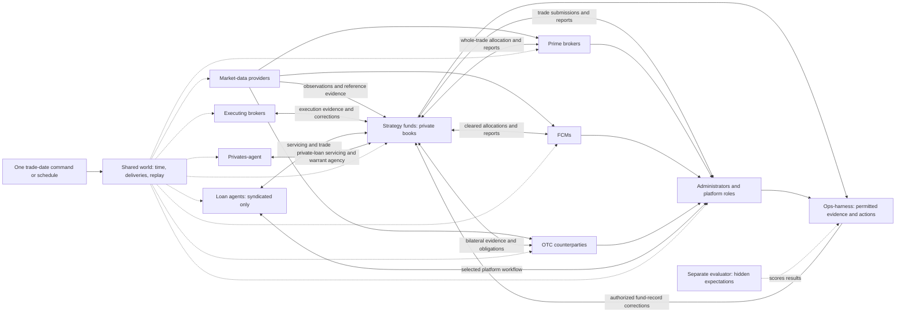

# Vertical map

Updated 13 November 2026 after the [decision-audit interview](interview-handoff.md#decision-audit-interview) and separate privates-agent decision. The nine-vertical roster is confirmed; detailed behavior, interfaces and implementation plans remain for the linked interviews. Read [project direction](project-direction.md) and [shared terms](ops-harness/shared-terms.md).

## Keep three dimensions separate

1. **Institutional actors:** the nine agreed verticals below, each potentially containing multiple institution instances.
2. **Shared support:** scenarios, routing, time, replay, evaluation, common exchange meanings and infrastructure. These do not automatically require separate services or repositories.
3. **Products and workflows:** the agreed instruments cross actor boundaries. Research packets are not deployment verticals.

One implementation may serve several instances, but each instance retains its own records, relationships and permitted information. A common institution name does not by itself combine PB, FCM and OTC records or permit netting between them. All nine actor verticals run autonomously on schedules and agents once set up: one trade-date trigger, no human runtime approvals/interventions/overrides, and no dependency on ops-harness. Their strongest frontier leaders make institutional judgments from prescribed incentives and researched examples.

## Agreed actors

| Actor brief | Owned responsibility | Boundary to settle in interview |
| --- | --- | --- |
| [Funds](funds.md) | Twelve strategy-fund portfolios, internal bookings, whole-trade financing allocation and recipient files | Exact mandates, portfolio research, execution origin and rule inputs |
| [Prime brokers](prime-brokers.md) | PB-side records, financing, settlement and reports | Eligible products, account terms, accept/reject behavior and supplied evidence |
| [OTC counterparties](otc-counterparties.md) | Bilateral swap and OTC-option records, communications, calculations and calls | Exact terms, valuation inputs and whether this vertical also represents a cleared-trade executing dealer |
| [FCMs](fcms.md) | Listed-futures and applicable cleared-CDS account records, margin and reports | Executing-party versus FCM versus clearinghouse roles; eligible contracts and independent inputs |
| [Administrators](administrators.md) | Fund-administrator records plus platform-style matching, affirmation and reconciliation evidence | Preserve identifiable provider roles and outputs; full fund accounting is not automatically required |
| [Market-data providers](market-data.md) | Delivery of selected historical observations and relevant reference data | Actual coverage, timing, missing observations and instrument-master ownership |
| [Loan agents](loan-agents.md) | Syndicated-loan servicing evidence and communications only | Fully funded secondary assignments first; platform split, lender/borrower evidence and borrower representation |
| [Privates-agent](privates-agent.md) | Private-loan servicing and private-warrant agency | Cash interest/simple PIK; cash/cashless exercise, registers, notices and pending delivery evidence |
| [Executing brokers](executing-brokers.md) | Independent execution-side records, fills/recaps and corrections | Product coverage, synthetic venue evidence and messages to the fund/carrying party |

No separate month-1 custodian or post-trade vertical. Platform evidence is grouped under administrators as a build choice, without asserting that those services are legally or operationally the fund administrator. Borrowers, venues and clearinghouses are not additional approved verticals; decide the minimum evidence/behavior needed within the existing design.

## Shared and product responsibilities

| Starting point / owner | Responsibility |
| --- | --- |
| [Ops-harness](ops-harness/starting-point.md) | Reconciliation, settlement, reference data, financing and treasury; autonomous authorized fund-record corrections, exact-message approval for external communications; principal implementation month 2 |
| [Shared terms](ops-harness/shared-terms.md) | Canonical project vocabulary owned by ops-harness; does not define a central ledger or wire schema |
| [Shared world](shared-world.md) | Hands-on scenario/integration/evaluation and valuation work; evidence playback/logs first, full processing reconstruction later; support unattended actor runs |
| [Ops-infra](../../ops-infra/readme.md) | Current workspace/runtime provisioning, access, isolation and recovery guidance |

A common exchange definition may be useful without creating an `ops-contracts` repository/package now. Its eventual form belongs in the shared interview. Market-data/reference responsibilities likewise need explicit ownership rather than a shared mutable store everyone can edit.

Build shared OMS and instrument-master foundations with independent actor variants as the intended future state. Actors selectively adopt subsequent shared improvements after compatibility checks. FINOS CDM remains the selected foundation for applicable definitions and verified calculations; coverage gaps require researched, approved supplements. Keep agreed terms versioned and establish requirements product by product before dependent implementation.

Shared valuation development does not centralize actor-private records or require a human price entry during ordinary runs. Prepared runtime services/calculations must be usable automatically. The harness's human approval policies must not be applied to the actors' own messages or decisions. The harness can correct authorized fund records; all other verticals correct their own records through their own mechanisms.

## Relationships

Arrows show selected logical evidence relationships, not exhaustive deliveries, direct database access or a settled transport. All roles can supply permitted evidence to the harness; those paths are shortened in the diagram for readability. Historical observations must be delivered according to the agreed availability rules, including to administrators when required.

## Product coverage and initial population

The [direction document](project-direction.md#product-scope) contains the exact product list and twelve fund names. Each fund has exactly one administrator and may have multiple other relationships. A trade is not split among PBs/FCMs. Start with one fund per trade; cross-fund block allocation is a later candidate. Eligible account choice is rule based inside the fund. Choose strategy portfolios first and size initial funding around them, keeping normal calls and contractual flows active.

The agreed strategy/portfolio follow-up must map each strategy to its first positions, trades, financing relationships and operational examples. The joint instrument-workflow follow-up must map the evidence path and one credible success example for every required instrument. Neither mapping is fully decided by the strategy names.

Private loans and private warrants route to privates-agent, while syndicated loans route to loan agents. Private loans remain in month 1 and come last in instrument implementation. Bilateral OTC options are explicitly included following the put/call discrepancy example. Listed options and FX remain research references, not additions to the agreed product list. The [audit answers](interview-handoff.md#decision-audit-interview) and actor briefs record the selected product depths and deferred lifecycle work.

## Relationship to existing work

The [current sim-funds README](../../sim-funds/readme.md) describes an earlier narrow demonstration: one long-only cash-equity fund, one PB account, 20 opening holdings, two historical days, 10 new trades/day, two day-2 price-only amendments, and PB/admin EOD CSVs. It describes documentation readiness, not completed world integration. Reuse useful examples and reconcile that repository in its own planning session; this package does not change it.

The current interview broadens intended month-1 scope. Do not let the old baseline silently remove shorts, financing, strategies or products from the new starting points. Conversely, new intent does not prove existing financial implementation or deployed behavior. The Halo runtime was not audited by this document task.

See [interview order and effort](README.md#interview-order-and-month-1-effort), [source reconciliation](source-review.md) and [handoff](interview-handoff.md).
